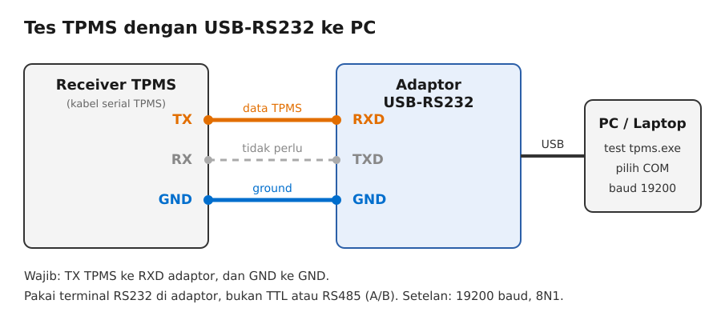
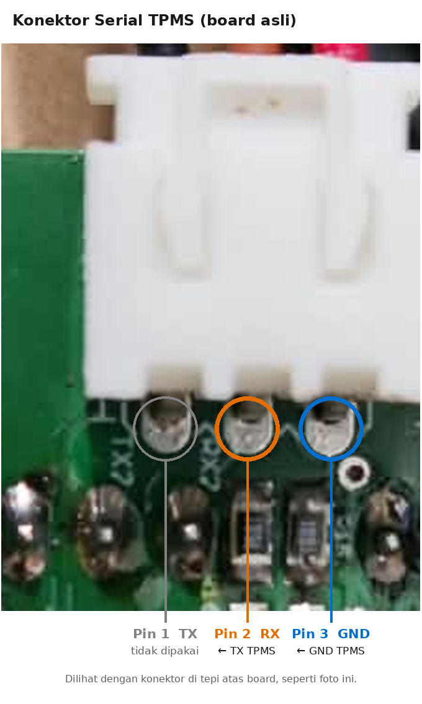
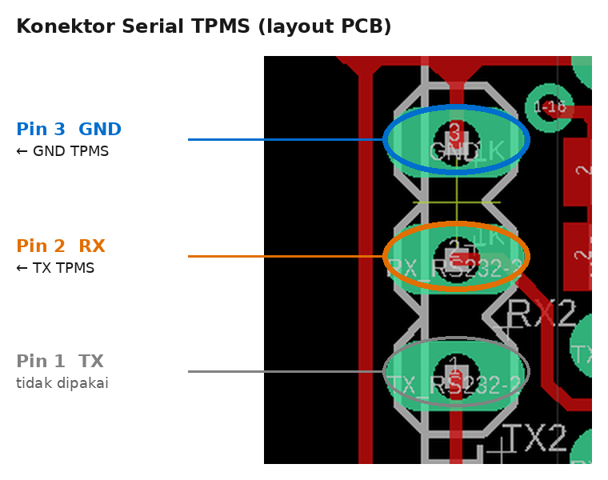

# TpmsDecryptor

Program PC (Windows) untuk membaca data **TPMS** (*Tire Pressure Monitoring System*) dari receiver TPMS lewat port serial.
Program menampilkan **tekanan, suhu, tegangan baterai sensor, dan status alarm** untuk **8 ban** sekaligus.

📘 **Panduan lengkap wiring dan tes di lapangan: [docs/PANDUAN.md](docs/PANDUAN.md)**

## Isi repo

| File | Keterangan |
|---|---|
| `test tpms.py` | Source program (Python + Tkinter + pyserial) |
| `test tpms.exe` | Program siap pakai untuk Windows (hasil build PyInstaller) |
| `test tpms.spec` | Konfigurasi PyInstaller untuk membuat `.exe` |
| `docs/PANDUAN.md` | Panduan wiring, cara tes, dan troubleshooting |
| `docs/img/` | Diagram wiring dan gambar pinout |
| `Screenshot 2026-11-13 095332.png` | Layout PCB (referensi pinout) |
| `WhatsApp Image 2026-11-13 at 09.47.03.jpeg` | Foto board asli |
| `H0a87a294c7434f49b049a39a063cade2d.png` | Contoh adaptor USB-RS232 |

## Mulai cepat

1. Sambungkan **TX TPMS ke RXD** adaptor USB-RS232, dan **GND ke GND**.
2. Colok adaptor ke PC, lalu catat nomor COM-nya di Device Manager, bagian *Ports (COM & LPT)*.
3. Jalankan `test tpms.exe`, klik **Refresh**, pilih COM, pilih BAUD **19200**, lalu klik **Connect**.
4. Data mentah (hex) muncul di panel **RAW SERIAL**, dan kotak **TIRE 1–8** terisi otomatis.

## Wiring

Aturan utamanya: **TX dari TPMS masuk ke RX penerima, dan GND ke GND.**
Program hanya membaca, jadi jalur RX TPMS tidak perlu disambung.

### Tes ke PC lewat USB-RS232



| Receiver TPMS | Adaptor USB-RS232 |
|---|---|
| TX | RXD |
| GND | GND |
| RX | tidak perlu |

Pakai terminal **RS232** di adaptor, jangan terminal TTL atau RS485 (A/B).

### Ke board PCB (konektor Serial TPMS)

<p>
  
  &nbsp;
  
</p>

| Pin konektor Serial TPMS | Sambung ke |
|---|---|
| Pin 2 · **RX** (tengah) | **TX TPMS** |
| Pin 3 · **GND** | **GND TPMS** |
| Pin 1 · TX | tidak dipakai |

Pada board asli (konektor di tepi atas), urutan pin dari kiri ke kanan adalah **TX – RX – GND**.
Pada layout PCB, urutannya dari atas ke bawah **GND – RX – TX**.
Jangan sambungkan TX TPMS langsung ke pin MCU, karena sinyal RS232 harus lewat konektor ini.
Detail lengkapnya ada di [docs/PANDUAN.md](docs/PANDUAN.md#bagian-b--menyambung-tpms-ke-board-pcb).

## Pengaturan serial

| Parameter | Nilai |
|---|---|
| Baud rate | 19200 |
| Data bit | 8 |
| Parity | None |
| Stop bit | 1 |

## Format data

Setiap paket panjangnya **10 byte**:

```
55 AA 0A | ID | P | T | ST | BAT | -- | CS
```

| Byte | Isi | Cara menghitung |
|---|---|---|
| 0–1 | Header | selalu `55 AA` |
| 2 | Panjang/tipe | selalu `0A` |
| 3 | Posisi ban | `01`–`08` |
| 4 | Tekanan | `nilai × 5.5 − 100` kPa (dibagi 100 untuk bar) |
| 5 | Suhu | `nilai − 50` °C |
| 6 | Status | bit alarm (lihat tabel di bawah) |
| 7 | Tegangan baterai sensor | `nilai ÷ 10` V |
| 8 | Belum diketahui | tidak ditampilkan, tapi ikut dihitung checksum |
| 9 | Checksum | XOR byte 0 sampai 8 |

| Bit status | Nilai | Arti |
|---|---|---|
| 0 | `0x01` | HighTemp: suhu tinggi |
| 1 | `0x02` | Low Pres: tekanan rendah |
| 2 | `0x04` | HighPres: tekanan tinggi |
| 3 | `0x08` | Leak: ban bocor |
| 4 | `0x10` | Low Volt: baterai sensor lemah |
| 5 | `0x20` | NoSignal: sensor tidak terdengar |

Contoh paket berikut dibaca sebagai **Ban 1, 802 kPa (8.02 bar), 25 °C, 3.0 V, tanpa alarm**:

```
55 AA 0A 01 A4 4B 00 1E 00 05
```

## Menjalankan dari source

Butuh Python 3 untuk Windows (Tkinter sudah termasuk di dalamnya) dan pyserial:

```bash
pip install pyserial
```

```bash
python "test tpms.py"
```

## Build ulang `.exe`

```bash
pip install pyinstaller
```

```bash
pyinstaller "test tpms.spec"
```

File hasil build ada di `dist/test tpms.exe`.

## Keterbatasan yang diketahui

- Program membaca per 10 byte tanpa mencari header `55 AA`. Kalau tersambung di tengah paket, data bisa bergeser.
  Solusinya: klik **Disconnect**, tunggu sebentar, lalu **Connect** lagi.
- Paket yang gagal (header salah atau checksum salah) tidak ditampilkan sebagai pesan error. Paket itu hanya terlihat di RAW SERIAL, dan kotak ban tidak berubah.
- Hanya posisi ban `01`–`08` yang ditampilkan.
- Rumus tekanan, suhu, dan baterai mengikuti kode program dan sebaiknya dicocokkan dengan alat ukur.
