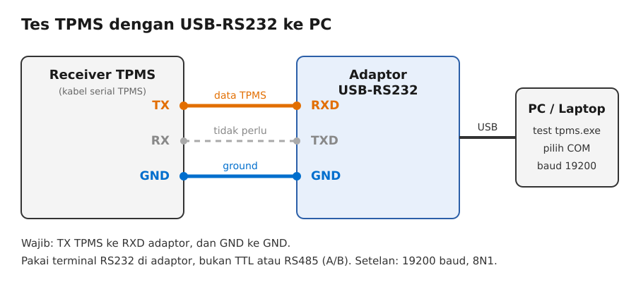
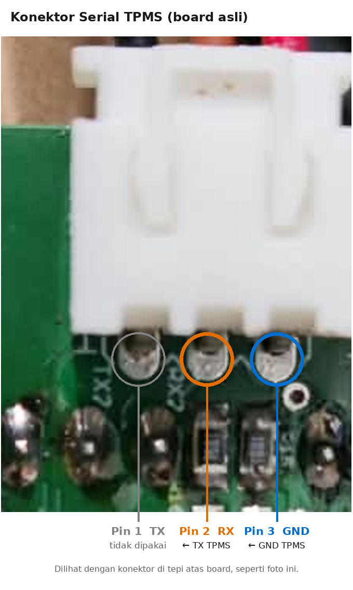
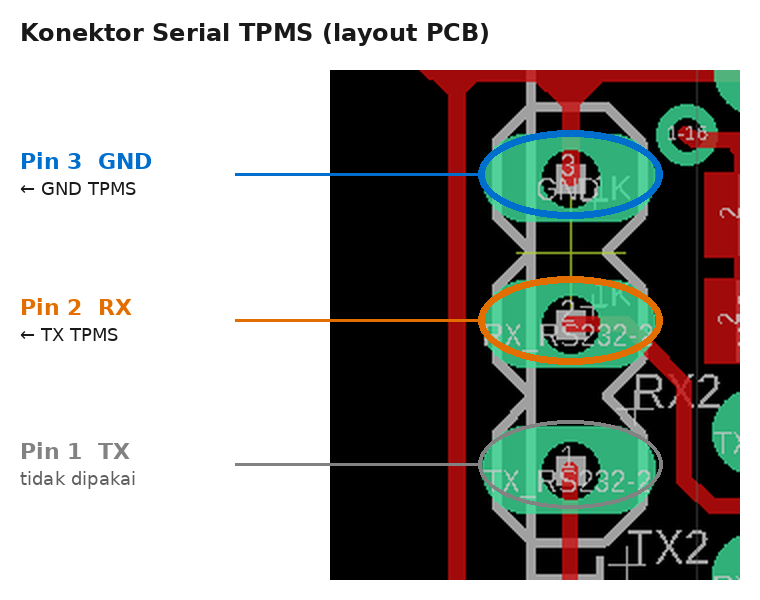
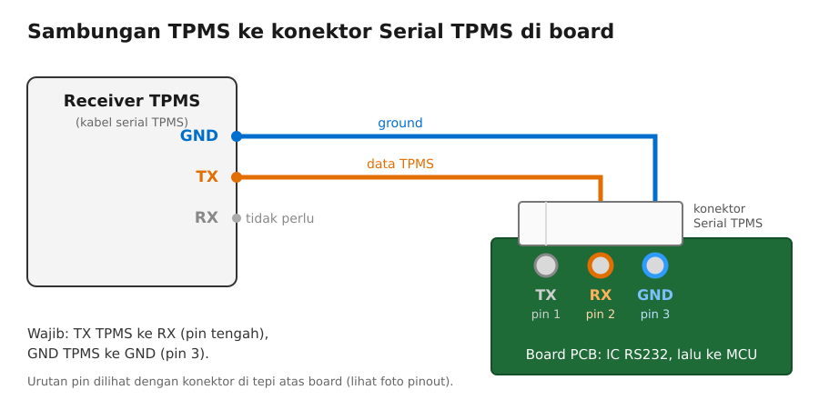

# Panduan Wiring dan Tes TPMS

Panduan ini menjelaskan dua cara menyambung receiver TPMS:

- **[Bagian A](#bagian-a--tes-tpms-ke-pc-lewat-usb-rs232):** tes di lapangan dengan adaptor USB-RS232 dan program PC.
- **[Bagian B](#bagian-b--menyambung-tpms-ke-board-pcb):** menyambung TPMS ke konektor Serial TPMS di board PCB supaya terbaca oleh MCU.

Aturan utamanya sama untuk kedua cara: **TX dari TPMS masuk ke RX penerima, dan GND ke GND.**
Program hanya membaca dan tidak pernah mengirim apa pun ke TPMS, jadi jalur RX TPMS tidak perlu disambung.

---

## Bagian A — Tes TPMS ke PC lewat USB-RS232

### A1. Yang perlu disiapkan

- Receiver TPMS yang sudah menyala, beserta kabel serialnya
- Adaptor USB-RS232 ([contoh foto](../H0a87a294c7434f49b049a39a063cade2d.png))
- PC atau laptop Windows berisi `test tpms.exe`
- Kabel jumper secukupnya

### A2. Wiring



| Receiver TPMS | Adaptor USB-RS232 | Keterangan |
|---|---|---|
| **TX** | **RXD** | Jalur data TPMS (wajib) |
| **GND** | **GND** | Ground bersama (wajib) |
| RX | TXD | Tidak perlu disambung |

Hal yang perlu diperhatikan:

- **Baca label terminal di casing atau stiker adaptor.** Urutan terminal berbeda-beda antar merek, jadi jangan menebak dari posisi.
- **Pakai terminal RS232 (RXD/GND).** Kalau adaptor juga punya terminal lain, misalnya A/B untuk RS485 atau terminal TTL, jangan pakai terminal tersebut. Sinyal RS232 tidak terbaca di RS485, dan tegangannya bisa merusak input TTL.
- **Kalau kabel TPMS sudah memakai colokan putih untuk board** (lihat [Bagian B](#bagian-b--menyambung-tpms-ke-board-pcb)): kabel yang masuk ke **pin tengah (RX)** adalah TX dari TPMS, dan kabel yang masuk ke **pin GND** adalah ground TPMS.

### A3. Driver dan nomor COM

1. Colok adaptor ke port USB PC.
2. Buka **Device Manager** (klik kanan tombol Start, lalu pilih *Device Manager*).
3. Buka bagian **Ports (COM & LPT)**, lalu catat nomor COM adaptor, misalnya `COM5`.
4. Kalau adaptor tidak muncul atau ada tanda seru kuning, pasang driver yang sesuai dengan chip adaptor (misalnya CH340, CP210x, FTDI, atau PL2303). Jenis chip biasanya tertera di keterangan dari penjual.

### A4. Menjalankan program

1. Klik dua kali `test tpms.exe`. Program terbuka tanpa jendela hitam (console), dan itu normal.
   Kalau Windows menampilkan *"Windows protected your PC"*, klik **More info** lalu **Run anyway**. Peringatan ini muncul karena file .exe tidak ditandatangani digital.
2. Klik **Refresh**, lalu pilih nomor COM dari langkah A3 di kolom **COM**.
3. Pastikan **BAUD = 19200**.
4. Klik **Connect** sekali. Di panel RAW SERIAL akan muncul `CONNECTED COM5 @ 19200`.
5. Tunggu data masuk. Setiap paket muncul sebagai satu baris hex di RAW SERIAL, dan kotak ban yang sesuai akan terisi.
6. Setelah selesai, klik **Disconnect** supaya port COM dilepas.

### A5. Membaca hasil

Contoh satu baris di RAW SERIAL:

```
55 AA 0A 01 A4 4B 00 1E 00 05
```

Baris di atas tampil di kotak **TIRE 1** seperti ini:

```
TIRE 1

Pressure : 802.0 KPA
           8.02 BAR

Temp     : 25 °C
Battery  : 3.0 V

Leak     : False
Low Volt : False
NoSignal : False
Low Pres : False
HighPres : False
HighTemp : False
```

Cara cepat mengecek satu baris RAW:

- Paket yang benar selalu diawali **`55 AA 0A`**.
- Byte ke-4 adalah **posisi ban**, nilainya `01` sampai `08`.
- `True` pada daftar alarm berarti alarm tersebut aktif:

| Baris | Arti |
|---|---|
| Leak | Ban bocor |
| Low Volt | Baterai sensor lemah |
| NoSignal | Sensor tidak terdengar |
| Low Pres | Tekanan rendah |
| HighPres | Tekanan tinggi |
| HighTemp | Suhu tinggi |

Rincian lengkap format paket ada di [README](../README.md#format-data).

---

## Bagian B — Menyambung TPMS ke board PCB

### B1. Pinout konektor Serial TPMS

<p>
  
  &nbsp;
  
</p>

| Pin | Fungsi | Tulisan di PCB | Sambung ke |
|---|---|---|---|
| 1 | TX | `TX2` | Tidak dipakai |
| **2 (tengah)** | **RX** | `RX2` | **TX dari TPMS** |
| **3** | **GND** | – | **GND TPMS** |

Posisi pin berbeda tergantung cara melihatnya:

- **Board asli** (konektor di tepi atas, seperti foto kiri): dari kiri ke kanan **TX – RX – GND**.
- **Layout PCB** (gambar kanan): dari atas ke bawah **GND – RX – TX**.

Pada kedua posisi, **RX selalu berada di tengah.**

### B2. Wiring



### B3. Langkah pemasangan

1. Matikan power board dan receiver TPMS sebelum memasang kabel.
2. Sambungkan **TX TPMS ke pin RX (tengah)**.
3. Sambungkan **GND TPMS ke pin GND**.
4. Biarkan pin TX board tidak tersambung.
5. Pastikan kabel masuk ke **konektor Serial TPMS**, bukan ke konektor putih di sebelahnya (itu port serial lain).
6. Nyalakan board dan TPMS. LED indikator RX di dekat konektor (**LED10**) seharusnya berkedip saat data TPMS masuk.

> **Penting:** jangan sambungkan TX TPMS langsung ke pin MCU. Sinyalnya berlevel RS232, jadi harus lewat konektor Serial TPMS. IC RS232 di board yang menurunkan level sinyal sebelum masuk ke MCU.

---

## Troubleshooting

| Gejala | Kemungkinan penyebab | Solusi |
|---|---|---|
| Nomor COM tidak muncul di daftar | Driver adaptor belum terpasang, atau kabel USB longgar | Pasang driver (langkah A3), colok ulang, lalu klik **Refresh** |
| Muncul error saat **Connect** (`could not open port`, `Access is denied`) | Port sedang dipakai program lain, nomor COM salah, atau Connect diklik dua kali | Tutup program serial lain, klik **Disconnect**, lalu Connect lagi sekali |
| RAW SERIAL kosong | TX/RX tertukar, GND belum tersambung, TPMS belum menyala, atau memakai terminal adaptor yang salah | Cek wiring A2. Coba pindahkan kabel TX TPMS ke TXD adaptor. Pastikan memakai terminal RS232 |
| RAW SERIAL kosong padahal wiring sudah benar | Sensor ban belum mengirim data | Tunggu beberapa saat, karena sensor biasanya mengirim berkala |
| Ada data di RAW, tapi baris tidak diawali `55 AA 0A` | Baud rate salah, atau paket bergeser karena program tersambung di tengah paket | Pastikan BAUD 19200. Klik **Disconnect**, tunggu sebentar, lalu **Connect** lagi |
| Baris diawali `55 AA 0A` tapi kotak ban tidak berubah | Checksum salah karena gangguan di kabel, atau posisi ban di luar `01`–`08` | Periksa sambungan dan GND, gunakan kabel yang lebih pendek, lalu cek byte ke-4 |
| Data tiba-tiba berhenti masuk | Adaptor tercabut atau longgar. Program berhenti membaca tanpa menampilkan pesan | Klik **Disconnect**, colok ulang adaptor, klik **Refresh**, lalu **Connect** |
| LED10 di board tidak berkedip | Kabel TPMS tidak masuk ke pin RX, atau tercolok ke konektor yang salah | Cek pinout B1 dan langkah B3 nomor 5 |
| Antivirus menghapus atau memblokir `test tpms.exe` | File .exe buatan PyInstaller kadang dianggap mencurigakan | Jalankan dari source (lihat README), atau build ulang sendiri |

---

## Checklist lapangan

**Tes ke PC (USB-RS232)**

- [ ] TX TPMS sudah ke RXD adaptor
- [ ] GND TPMS sudah ke GND adaptor
- [ ] Memakai terminal RS232, bukan RS485 atau TTL
- [ ] Nomor COM sudah dicek di Device Manager
- [ ] BAUD 19200, lalu Connect
- [ ] Baris RAW diawali `55 AA 0A`
- [ ] Kotak ban terisi sesuai posisi ban

**Pasang ke board**

- [ ] Power board dan TPMS mati saat memasang
- [ ] TX TPMS sudah ke pin RX (tengah) konektor Serial TPMS
- [ ] GND TPMS sudah ke pin GND
- [ ] Bukan konektor putih di sebelahnya
- [ ] LED10 berkedip saat data TPMS masuk
